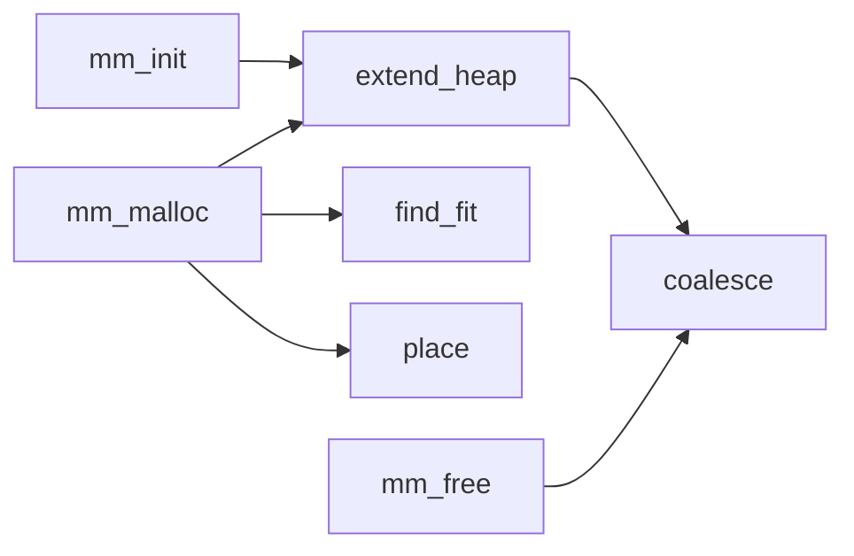
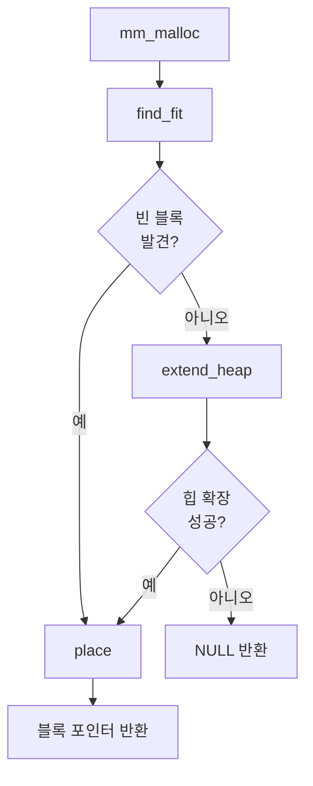

## 이번 주 목표

- **설계**
  - 목표: 구현에 이용할 나만의 지표 만들기 (예: 플로우차트)
    - 결과: 70% (나만의 방식을 고민하기 보단 AI나 동료의 도움을 받아 플로우차트를 만들었다.)
- **태도**
  - 목표: 설계와 구현, 트러블슈팅한 내용에 대해 메모에 꾸준하게 기록
    - 결과: 80% (시행착오에 대한 결과와 해결 방법을 작성했다. 원인은 내가 분석하기보단 AI와의 대화 기록을 통해 작성했다.)

## 시도한 접근 방식

설계할 때 종이와 펜을 쓰면 참 좋겠지만, 그림을 그리기 시작하면 특정 한 부분에 매몰되어 다른 것들을 생각하지 못할 때가 많다. 무엇보다 나는 손이 느리기 때문에 펜으로 글을 쓰는 것이 타자 속도보다 더 느렸다. 그래서 내가 시도한 방법은 펜을 드는 것보단 메모장에 생각을 작성하고 순번을 매겨 이것을 보고 플로우차트를 그리는 방법을 사용했다.

특히 교재에 있는 코드의 흐름을 플로우차트로 그려보는 것도 나쁘지 않았다. 글만 가득한 것보단 그래도 뭔가 도형이 있고 그림이 있는 편이 보기 편하고 이해하기도 쉽기 때문이다. 플로우차트는 [Mermaid](https://mermaid.ai/open-source/intro/)라는 다이어그램 언어가 있는데 이를 이용해 플로우차트를 작성했다.



_주요 함수의 호출 관계. 화살표는 함수 사이의 호출 관계를 나타낸다._

할당 요청의 흐름은 빈 블록을 찾았는지에 따라 달라진다. 크기 정렬 등의 세부 단계는 생략하고 핵심 분기를 정리하면 다음과 같다.



이처럼 함수의 호출 관계라던가 그 함수 내의 흐름을 파악하고 나니 코드가 훨씬 읽기 쉬워졌다.

## 문제와 해결 과정

next fit을 구현하고 난 뒤에 발생한 문제가 있었다. 점수를 높여보려고 `CHUNKSIZE`를 줄였더니 갑자기 Segmentation Fault가 발생하는 문제였다. 문제를 찾는 과정은 이랬다.

1. 모든 테스트 케이스에서 발생한 것은 아니었고, `realloc` 관련 테스트케이스에서만 문제가 발생했기 때문에 원인은 `realloc`에 있다는 것을 알게 되었다.
1. 의심되는 변경으론 next fit 구현과 `mm_realloc()`의 배치 정책을 `mm_malloc()`과는 다르게 first fit으로 변경한 것이다.
1. 버전 기록을 바꿔 `CHUNKSIZE`에 변화를 줘본다.
1. 문제의 커밋을 확인했다.

하지만 코드의 흐름에는 문제가 없어서 몇 시간 동안 같은 문제를 붙잡고 고민하다가 포기하고 AI에게 물어보았다. AI가 원인을 금방 찾아주었는데 그 원인은 내가 전혀 예상치 못한 곳에 있었다.

```diff
        ...
        char *nextptr = NEXT_BLKP(ptr);
        if (lastp == nextptr)
        {
-           lastp = nextptr;
+           lastp = ptr;
        }
        ...
```

문제를 발견하자 정신이 멍해졌다. 위의 빨간줄에 있는 잘못 사용된 변수 하나 때문에 몇 시간을 소모했다. 디버깅이 힘든 환경이었기에 이런 오탈자 하나하나를 신경 써야한다는 것을 알게 되었다.

## 새롭게 배운 점

알고리즘 문제를 풀 때와는 다르게 하나의 함수가 다른 함수를 호출하며 동작하는 것을 느낄 수 있는 시간이었다. 즉, 하나를 바꾸면 다른 함수의 동작에 영향이 크게 미칠 것임을 느낄 수 있었다. 이를 유연하게 생각할 수 있는 능력을 키운 것 같다. malloc lab에서는 관련 개념도 익혔지만 이는 메모로 작성했기에 배운 개념보단 다른 것을 나열해보겠다.

- 항상 최적은 없다. 경우에 따라 유연하게 변경해야 한다.
  - `CHUNKSIZE`를 줄여 이용률을 높이는 등 상수 하나로도 성능이 달라질 수 있다.
- 테스트 케이스를 유심히 봐야 어느 부분에서 문제가 생길지 파악할 수 있다.
  - 단순히 눈으로만 보지 않고 그림을 그려서 파악하는 것이 필요하다. ~~내 경우엔 그림판을 사용했다.~~
- 필요하다면 자신이 직접 테스트 케이스를 만들어서 원하는 동작이 이루어지는지 확인해야 한다.
  - 실무에서는 당연히 누군가가 테스트 케이스를 만들어주지 않을테니 내가 스스로 해야 한다.
- 좋은 개발자의 덕목 중 하나는 경우의 수를 따지고 원인을 분석하는 것이다.

## 다음 주 계획

- 개념 학습 후 설계를 명확히 하여 구현 시간을 예상하여 목표 세우기
- [Pintos](https://casys-kaist.github.io/pintos-kaist/) 때 팀원에게 폐를 끼치지 않기 위해 피곤하지 않도록 자기 관리하기
- 이번 주차에 손이 많이 느리다던가 설계가 느리다던지를 느꼈다. 따라서 설계 속도를 향상시킬 방법 찾아볼 생각이다.
