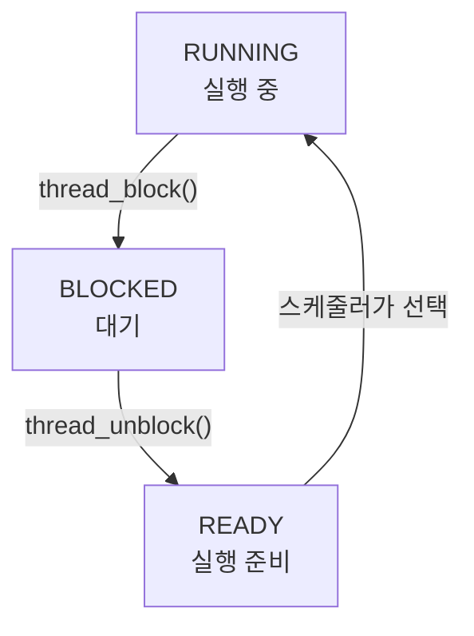

## 이번 주 목표

- **문제해결**
  - 목표: 모든 테스트 케이스를 AI 도움 없이 PASS
    - 결과: 70% (최종적으로 누적 27개 테스트를 통과했지만, 디버깅 과정에서 AI의 도움을 받았다.)

- **설계**
  - 목표: 구현할 때 막히지 않을 정도로 꼼꼼히 설계
    - 결과: 70% (Alarm Clock은 구현을 이어갈 수 있을 정도로 설계했지만, 뒤로 갈수록 시간이 부족해 설계가 부실해졌다.)

- **구현**
  - 목표: 문서를 보고 바로 C언어로 작성
    - 결과: 80% (체크리스트를 만들어두니 구현하기 수월했다. 다만 포인터와 리스트 사용에서는 실수가 많았다.)

- **품질**
  - 목표: 버그 없는 코드 작성
    - 결과: 60% (설계의 구체성에 따라 결과가 많이 달랐다. 특히 인터럽트 상태와 실행 순서를 충분히 고려하지 못해 오류가 발생했다.)

- **유지보수**
  - 목표: 수정하기 쉬운 코드 작성
    - 결과: 80% (최댓값을 찾는 순회 코드를 기존 함수로 정리하고 싶었지만 시간상 진행하지 못했다.)

- **협업**
  - 목표: 최선의 분업 방식을 찾아 적용하기
    - 결과: 70% (파트별로 함께 구현하거나 기능을 나누는 방식을 적용했다. 각 방식의 장단점은 경험했지만, 어떤 방식이 가장 적합한지는 더 확인해야 한다.)

- **태도**
  - 목표: 구현해야 하는 내용을 이해할 수 있을 만큼 학습
    - 결과: 70% (Alarm Clock은 흐름을 이해하며 진행했지만, 우선순위 기부부터 의존 관계와 상태 변화를 이해하기 어려웠다.)

- **비즈니스 이해**
  - 목표: 테스트 케이스의 요구사항 파악
    - 결과: 80% (익힌 개념을 바탕으로 테스트 케이스의 요구사항을 실행 순서로 이해할 수 있었다.)

- **AI 활용**
  - 목표: 개념 학습과 메모에 AI 활용
    - 결과: 80% (AI를 활용해 [Pintos 공식 문서](https://casys-kaist.github.io/pintos-kaist/)를 한국어로 정리했다. 정리한 내용을 실제 구현에 적용하는 데에는 시간이 더 필요했다.)

- **학습 민첩성**
  - 목표: 스레드가 대기하고 깨어나는 지점을 빠르게 파악하기
    - 결과: 70% (스레드 상태 전환과 동기화 함수의 동작을 이해하는 데 예상보다 오래 걸려 구현 시간이 빠듯했다.)

## 시도한 접근 방식

### 문서를 구현 체크리스트로 바꾸었다.

Alarm Clock에서는 수정할 파일과 함수, 추가할 변수, 함수 호출 순서를 먼저 정리했다. `struct thread`에 깨어날 시각을 저장하고, 수면 목록에 등록한 뒤 스레드를 차단하며, 타이머 인터럽트에서 시간이 된 스레드를 깨우는 흐름이었다. 이렇게 작업을 구체적으로 나누니 구현할 때 무엇을 해야 할지 다시 고민하는 시간이 줄었다.

다만 우선순위 스케줄링과 기부로 넘어가면서 같은 수준의 설계를 유지하지 못했다. 전체 개발 기간이 내 역량보다 짧았고, 개념을 이해하는 데 시간이 걸리면서 설계를 충분히 마치기 전에 구현을 시작했다. 이후에는 구현하면서 빠진 조건을 발견하고 보완하는 일이 많아졌다.

### 테스트 코드를 읽어 요구사항을 확인했다.

테스트 케이스의 실행 과정을 분석했다. 어떤 스레드를 생성하고, 언제 우선순위가 바뀌며, 어느 시점에 CPU를 양보해야 하는지 순서대로 정리했다.

예를 들어 우선순위가 높은 자식 스레드를 생성하는 테스트에서 부모의 메시지만 출력되는 것을 보고, 새 스레드에 의한 즉시 선점이 빠져 있다는 점을 파악할 수 있었다. 기대 출력과 실제 출력의 차이를 보니 개념을 적용하는 것이 도움이 됐다.

### 파트마다 협업 방식을 다르게 적용했다.

Alarm Clock과 Advanced Scheduler는 함께 진행하고, 우선순위 파트는 구현할 기능을 나누었다. MLFQS에서는 테스트 분석도 분담했다.

함께 진행할 때와 기능을 나눌 때의 차이를 경험할 수 있었다. 기능을 나누면 작업이 빨리 끝나지만 이해하는 데에 시간이 걸리고, 함께 진행할 경우는 그 반대이다. 각자에게 맞는 방식을 찾기는 어려운 것 같다.

## 문제와 해결 과정

### Alarm Clock에서는 리스트와 스레드 상태를 잘못 이해했다.

처음에는 `list_elem`에 데이터를 저장할 수 있다고 생각했고, `list_head()`와 `list_front()`의 차이도 혼동했다. 특히 `list_insert_ordered()`에 스레드 내부의 `elem` 주소 대신 `thread_current()`를 전달해 실패를 겪었다. `&thread_current()->elem`을 전달하도록 수정한 뒤 테스트를 통과했다.

함수의 동작도 예상과 달랐다. `thread_block()`을 호출하면 나중에 다시 실행될 때까지 다음 코드가 진행되지 않으며, `thread_unblock()`은 준비 큐 삽입까지 처리한다는 점을 확인했다. 이에 따라 수면 목록에 먼저 등록한 뒤 차단하도록 순서를 정리했다. 두 작업 사이에 타이머 인터럽트가 끼어들 수 있으므로 해당 구간을 보호하는 것도 필요했다.

### `sema_up()`에서는 자료구조와 상태 갱신 순서를 함께 수정해야 했다.

가장 높은 우선순위의 대기자를 찾는 과정에서, 해당 목록이 사용하는 `elem` 대신 `donation_elem`을 기준으로 스레드 주소를 계산했다. 대기 목록에서 제거하지 않은 스레드를 준비 큐로 옮기려는 문제도 있었다.

또한 세마포어 값을 증가시키기 전에 선점을 검사하면, 깨어난 스레드가 여전히 0인 값을 보고 다시 대기할 수 있었다. 목록에 맞는 연결 멤버를 사용하고, 대기 목록에서 제거한 뒤 깨우며, 세마포어 값 갱신을 마친 후 선점을 판단하도록 수정했다.

### `priority-fifo` 실패는 테스트 간 실행 경로를 비교하며 원인을 좁혔다.

`priority-change`, `priority-preempt`, `alarm-priority`는 통과했지만 `priority-fifo`가 실패했다. 실패 당시 버전에서 `preempt_if_needed()`만 최신 버전으로 교체했을 때 PASS가 나오는 것을 확인해 조사 범위를 좁혔다.

재현 당시 `priority-fifo`는 작업 스레드를 만들기 전에 우선순위를 변경했고, 그 시점에는 `ready_list`가 비어 있었다. 이 경우 선점 검사 함수가 인터럽트를 끈 뒤 상태를 복구하지 않고 조기 반환했다. 반면 다른 테스트들은 해당 분기를 실행하지 않거나 호출 경로가 달랐다.

빈 리스트 분기에서도 이전 인터럽트 상태를 복구하도록 수정했다. 이때 무조건 인터럽트를 켜는 것이 아니라, 함수에 들어오기 전의 상태를 복원해야 한다는 점이 중요했다.

문제가 된 반환 경로를 코드로 정리하면 다음과 같다.

```diff
 enum intr_level old_level = intr_disable();
 if (list_empty(&ready_list)) {
+  intr_set_level(old_level);
   return;
 }
 /* 나머지 선점 판단 */
 intr_set_level(old_level);
```

## 새롭게 배운 점

### 스레드를 깨우는 것과 실제로 실행하는 것은 서로 다른 단계였다.

`thread_unblock()`은 스레드를 READY 상태로 옮긴다. 이후 스케줄러가 선택해야 실행되며, 실행된 뒤에도 자원을 얻을 수 있는지 다시 확인해야 할 수 있다. 세마포어와 조건 변수의 대기 흐름을 이해할 때 이 구분이 도움이 되었다.



_대기와 재개에 관련된 상태 전환만 표시했다. `thread_unblock()` 호출 직후 곧바로 RUNNING이 되는 것은 아니다._

### 순서와 반환 경로도 설계에 포함해야 한다.

수면 목록 등록과 스레드 차단, 대기 목록 제거와 준비 큐 삽입, 세마포어 값 갱신과 선점 판단은 순서에 따라 결과가 달라졌다. 인터럽트 복구 역시 함수 마지막에만 있으면 충분하지 않았다. 조기 반환을 포함한 모든 경로를 확인해야 했다.

## 다음 주 계획

- 개념 공부와 요구사항/테스트 분석 두 가지의 균형을 잘 맞출 수 있도록 시간 분배하기
- GitHub Projects의 칸반보드 말고 Slack의 칸반보드도 활용해보기
- 분석은 직접, 메모는 AI를 활용하기
