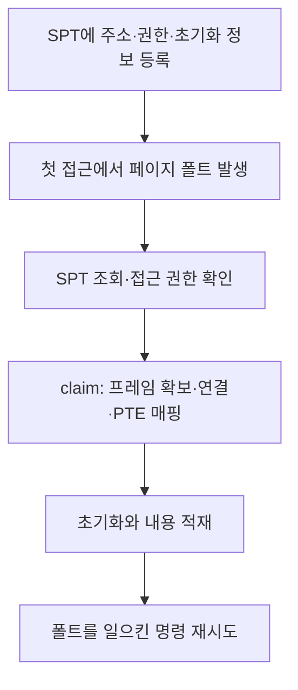



## 이번 주 목표

- **문제해결**
  - 목표: VM 구현 중 발생한 오류의 원인을 찾고 해결한다.
    - 결과: 80% (주요 오류는 수정했지만, 남은 테스트 실패의 원인을 모두 분석하지는 못했다.)
- **설계**
  - 목표: 가상 메모리 구조 설계.
    - 결과: 60% (각 단계의 역할을 구분했지만, 구현으로 이어질 수 있도록 잘 설계하지는 못했다.)
- **구현**
  - 목표: 설계를 보고 C언어로 구현한다.
    - 결과: 80% (기본 동작은 구현했다. 문법 때문에 막힌 적은 없다.)
- **품질**
  - 목표: 테스트로 구현한 기능의 동작을 확인한다.
    - 결과: 70% (기본 동작을 확인했지만, 실패 상황과 경계 조건의 검증은 부족했다.)
- **유지보수**
  - 목표: 함수 분리를 명확히 한다.
    - 결과: 70% (아직 top-down 방식을 적용하는 것이 어렵다.)
- **협업**
  - 목표: 막힌 부분과 이해한 내용을 팀원과 공유한다.
    - 결과: 80% (막힌 내용과 어디까지 이해했는지를 팀원에게 공유했다.)
- **태도**
  - 목표: 이해되지 않는 부분을 끝까지 확인한다.
    - 결과: 90% (모르는 부분을 질문으로 정리하고, 오류가 발생한 흐름을 계속 추적했다.)
- **비즈니스 이해**
  - 목표: 가상 메모리가 프로그램에 필요한 이유를 설명한다.
    - 결과: 30% (개별 기능의 요구사항은 이해했지만, 실제 활용 가치까지 설명하기는 부족했다.)
- **AI 활용**
  - 목표: 이해되지 않는 내용을 질문하며 AI를 학습에 활용한다.
    - 결과: 80% (자동 요약에서 질문 중심의 학습으로 바꿨지만, 답을 스스로 검증하는 과정은 더 필요했다.)
- **학습 민첩성**
  - 목표: 새로 배운 VM 개념을 구현에 적용한다.
    - 결과: 70% ([Memory Management](https://casys-kaist.github.io/pintos-kaist/project3/vm_management.html)까지는 할만했지만 그 뒤부터는 힘들었다.)

## 시도한 접근 방식

처음에는 코드 한 줄씩 해야 할 일을 나열하며 구현을 준비했다. 하지만 이 방식으로는 top-down을 생각하는 것이 힘들었다. 이후에는 기능이 성공했을 때 어떤 상태가 되어야 하는지 먼저 정하고, 그 상태를 만드는 작업을 함수별로 나누려고 했다.

문서를 공부하는 방법도 바꿨다. 이전에는 문서를 AI에게 넘겨 자동으로 정리하도록 했지만, 정리된 개념을 실제 설계로 연결하지 못했다.

[Memory Mapped Files](https://casys-kaist.github.io/pintos-kaist/project3/memory_mapped_files.html)에서는 문서를 직접 읽으며 이해되지 않는 부분을 먼저 질문으로 적었다.

- Stack Growth에서 쓴 함수를 여기서도 사용할 수 있을까?
- 기존 페이지와 겹치는지는 어떻게 확인할까?
- 독립적인 파일 참조를 얻는다는 것은 무슨 뜻일까?
- 프로세스가 끝날 때 매핑 해제를 어디에 연결해야 할까?

그 질문을 AI에게 던지며 필요한 정보를 하나씩 확인했다. AI가 설계나 구현에 가까운 답을 먼저 제시하는 경우도 있었지만, 내가 무엇을 이해하지 못했는지 확인하는 데에는 이 방식이 더 적절하다고 생각했다.

## 문제와 해결 과정

### 1. 페이지의 주소와 상태를 구분하기

프레임 확보를 처음 구상할 때는 `palloc_get_page()`가 반환한 주소와 `struct frame`을 혼동했다. 사용자 가상 주소인 `page->va`를 프레임의 커널 주소로 덮어쓰려는 시도도 있었다.

`palloc_get_page()`가 반환하는 값은 확보한 물리 프레임에 커널이 접근하기 위한 주소다. 반면 `struct frame`은 프레임의 상태와 연결된 페이지를 관리하기 위한 객체다.

사용자 주소인 `page->va` 역시 별도로 유지해야 했다.

- SPT는 사용자 가상 주소에 해당하는 페이지 정보를 찾는 데 사용한다.
- `frame->kva`는 커널이 실제 프레임의 내용을 읽고 쓰는 데 사용한다.

페이지 관리 객체, 사용자 주소, 커널 주소를 구분한 뒤에야 페이지와 프레임을 연결하는 흐름이 명확해졌다.

이 구분은 lazy loading에서도 중요했다.

lazy loading된 페이지는 SPT에는 등록되어 있지만, 아직 프레임과 PTE 매핑이 없는 상태다. 따라서 주소가 유효한지 판단할 때 현재 PTE만 확인하면 정상적인 페이지를 잘못된 접근으로 판단할 수 있다.

주소의 유효성과 쓰기 권한을 SPT의 페이지 정보에서 확인하도록 수정했다.

첫 접근의 흐름은 다음과 같이 정리할 수 있었다.



스택 확장에서는 이 상태 변화 때문에 다른 문제가 발생했다.

처음 SPT를 조회했을 때 지역 변수 `page`는 NULL이었다. 이후 스택 확장으로 페이지를 등록해도 기존 포인터는 자동으로 갱신되지 않았다. 그대로 `page->writable`에 접근하면서 잘못된 주소를 읽게 됐다.

스택 페이지 등록 이후 SPT를 다시 조회하도록 수정했다.

또 다른 버전에서는 같은 접근에서 페이지 폴트가 두 번 발생했다.

`vm_stack_growth()`가 SPT 등록만 수행하도록 바뀌었는데, 호출자는 그 성공값을 그대로 폴트 처리 성공으로 반환하고 있었다. 첫 번째 폴트에서는 등록만 이루어지고, 두 번째 폴트에서야 claim이 수행됐다.

이를 통해 **페이지 등록 성공과 접근 가능한 상태가 되는 것은 서로 다른 완료 조건**이라는 점을 알게 됐다.

확장에 실패했을 때만 즉시 반환하고, 성공했다면 SPT 재조회, 권한 확인, claim까지 이어 가도록 수정했다.

### 2. fork와 exec에서는 객체의 수명까지 복사하기

fork에서는 처음에 부모의 해시 항목을 자식 SPT에 그대로 삽입하려 했다.

하지만 부모와 자식은 별도의 페이지 객체와 초기화 정보를 가져야 한다.

초기화 정보를 복사하는 것만으로도 충분하지 않았다.

`load_aux` 자체를 새로 만들어도 내부 파일 포인터가 부모가 가진 객체를 가리키고 있다면, 부모가 먼저 종료하거나 exec한 뒤 자식이 lazy loading를 수행할 때 문제가 생길 수 있었다.

따라서 자식의 실행 파일 객체를 먼저 준비하고, 자식의 초기화 정보가 그 객체를 참조하도록 파일 복제와 SPT 복사의 순서를 바꿨다.

이 과정에서 lazy loading 상태를 복사하려면 단순히 값만 복사하는 것이 아니라, **나중에 그 값을 사용할 시점까지 참조 대상의 수명도 보장해야 한다**는 점을 배웠다.

exec에서는 반대 방향의 문제가 있었다.

기존 주소 공간을 정리하면서 SPT의 해시 버킷까지 해제했는데, 새 프로그램을 로드하기 전에 SPT를 다시 초기화하지 않았다. 그 결과 새로운 페이지를 등록할 때 해제된 버킷에 접근하게 됐다.

cleanup 이후 SPT 초기화를 추가했다.

이를 통해 자원을 정리할 때는 해제 함수 내부만 볼 것이 아니라, **해제 후에도 다시 사용할 객체가 있는지**까지 확인해야 한다는 점을 알게 됐다.

### 3. mmap에서는 소유권과 정리 범위를 나누기

mmap에서는 원래 FD를 닫은 뒤에도 매핑된 주소에 접근할 수 있어야 한다.

```text
파일 열기
  → mmap으로 페이지 등록
  → 원래 FD 닫기
  → 매핑된 주소에 처음 접근
  → 페이지 폴트에서 파일 읽기
```

파일을 실제로 읽는 시점에는 원래 FD가 이미 닫혀 있을 수 있다.

따라서 mmap이 사용할 독립적인 파일 참조를 `file_reopen()`으로 확보해야 했다.

처음에는 페이지를 순회할 때마다 region과 파일 참조를 만들었다. 반면 페이지의 적재 정보에는 원본 FD의 파일 객체를 넣고 있었다.

이 구조에서는 여러 페이지를 매핑할 때 region이 중복 생성되고, 원본 FD를 닫은 뒤에는 페이지가 더 이상 유효한 파일 객체를 참조하지 못할 가능성이 있었다.

그래서 수명을 다음과 같이 나눴다.

| 정보          | 역할과 수명                                                                                             |
| ------------- | ------------------------------------------------------------------------------------------------------- |
| `mmap_region` | 매핑 전체의 범위와 파일 참조를 보관한다. 모든 페이지가 정리된 뒤 파일을 닫고 해제한다.                  |
| `load_aux`    | 페이지 등록부터 첫 적재까지 필요한 정보를 전달한다. 적재 전에 페이지가 제거되는 경우에도 정리해야 한다. |
| `file_page`   | 초기화 이후에도 필요한 파일 위치와 유효 바이트 수를 보관하고, 변경 내용을 파일에 반영할 때 사용한다.    |

region과 재개방한 파일 참조는 매핑당 한 번 만들고, 페이지별 적재 정보만 반복문에서 생성하도록 수정했다.

첫 적재가 끝난 뒤에는 aux를 해제하되, 이후에도 필요한 파일 위치와 기록할 바이트 수는 `file_page`로 옮겼다. 각 페이지는 region이 가진 파일 참조를 빌려 사용하도록 했다.

페이지별 offset 처리에서도 문제가 있었다.

`offset + i * PGSIZE`로 각 페이지의 `ofs`를 계산했지만, 실제 aux에는 계속 처음 전달된 `offset`을 넣고 있었다. 계산한 `ofs`를 저장하도록 수정했다.

파일 끝을 포함한 페이지에서는 파일에서 읽은 영역과 0으로 채운 영역도 구분했다.

메모리에는 한 페이지 전체가 준비되더라도 실제 파일에 속하는 바이트는 더 작을 수 있다. 따라서 변경 내용을 파일에 반영할 때는 페이지 전체가 아니라 실제 파일 데이터에 해당하는 영역만 기록하도록 했다.

## 새롭게 배운 점

학습 방식에서 변화가 있었다.

문서를 읽은 뒤 바로 답을 찾기보다, 먼저 내가 이해하지 못한 부분을 질문으로 만드는 과정이 필요했다.

무엇을 알고 싶은지 명확해진 뒤에야 필요한 정보를 찾고 실제 설계와 구현에 연결하기가 쉬운 것 같다.

## 다음 주 계획

- 핵심 기능부터 구현 단위로 나누기
- AI가 작성한 코드를 이해하고 검증할 수 있도록 짜기
- 기술과 CS 개념 연결하기
