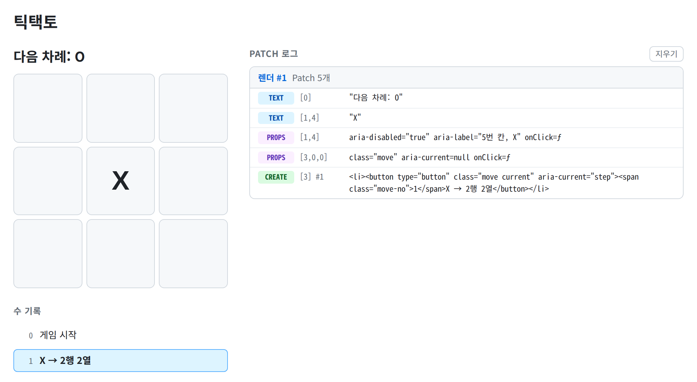
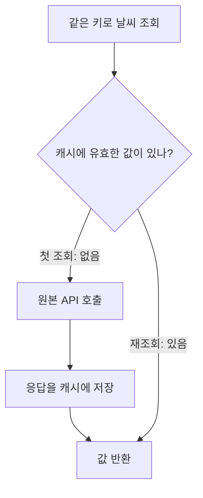
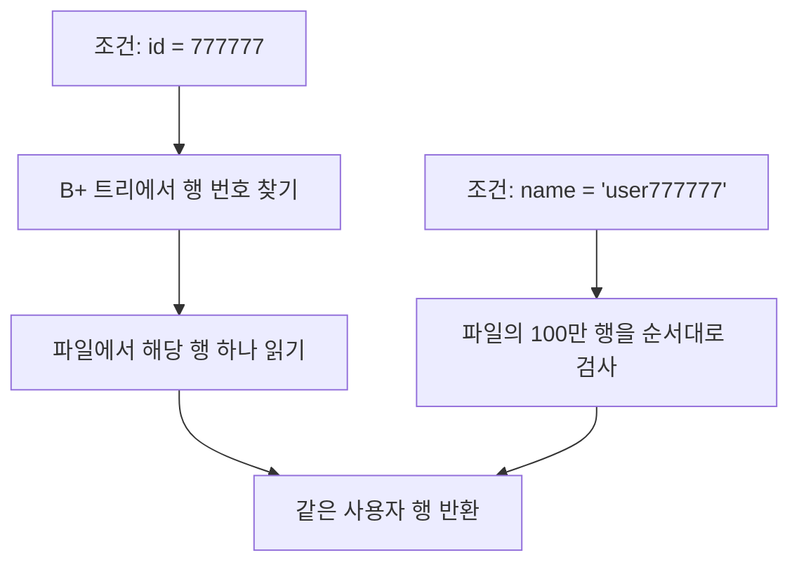

11주차에는 미니 React를, 12주차에는 미니 Redis와 DBMS를 만들었다. 과제를 하나씩 나눠 맡은 게 아니라, 세 과제마다 팀원 셋이 공통 형식을 정하고 모듈을 나눴다. AI를 써서 결과물을 만드는 건 빨랐지만, 결과가 나온 이유까지 설명하는 건 별개의 일이었다.

## 시도한 접근 방식

React에서는 AI가 선택지와 장단점을 정리하고, 사람이 고른 내용을 설계 문서에 남긴 뒤 구현과 테스트에 다시 AI를 활용했다. Phase 2는 18개 안건으로 나눴다. VNode와 Patch 형식을 먼저 맞춘 덕분에 다른 팀원과 구현할 것을 나누어 작업해도 곤란하지 않았다.

직전 Pintos 주차에서는 문서를 읽다 막히는 부분을 질문으로 적어 AI에게 물었다. 이번에는 답을 받는 데서 한 발 더 나아가, 그 답을 고를 근거로 어떤 입력과 결과를 볼지 정해야 했다. 세 과제 모두 설명은 일찍 만들 수 있었지만, 화면이나 HTTP 응답, 파일에서 직접 확인할 수 있는 결과는 따로 만들어야 했다.

## 공부한 것

### 미니 React: 틱택토 가운데 칸을 누르면 어디가 바뀔까?

빈 판에서 가운데 칸을 한 번 누른다. 아래는 **팀 시연 화면**이다. 오른쪽 로그에서 `[1,4]`는 가운데 칸을 가리킨다.

가운데 칸 말고도 차례 표시와 수 기록이 바뀌었다. 그래서 Patch가 한 건은 아니다. 대신 **판 위의 다른 여덟 칸을 대상으로 한 Patch는 없다.** 로그가 말해 주는 건 화면 전체를 다시 만들지 않았다는 것이지, 컴포넌트 함수가 다시 실행되지 않았다는 게 아니다. [틱택토 시연에서 직접 눌러 볼 수 있다.](https://nari3040.github.io/KJG-SW-AI-W11-React/tictactoe.html)

이 차이는 다음 화면을 계산하는 일과 실제 DOM에 반영하는 일을 나누면 이해하기 쉽다. 첫 단계에서는 편집한 HTML을 화면 트리인 Virtual DOM으로 바꿨고, 틱택토에서는 클릭으로 바뀐 게임 상태에서 새 트리를 만들었다. 두 경우 모두 이전 트리와 비교해 바뀐 부분만 실제 DOM에 반영했다. 게임 상태는 함수의 지역 변수가 아니라 루트 컴포넌트의 `useState` 슬롯에 남으므로, 함수가 다시 실행돼도 앞의 수가 사라지지 않는다.

### 미니 Redis: 같은 값을 두 번 요청하면 두 번째에는 무엇을 건너뛸까?

원본 API에서 날씨 값을 읽는다고 하자. 첫 조회 전에는 캐시가 비어 있고, 두 번째 조회는 값이 만료되기 전에 한다. 아래에서 원본을 부를지 결정하는 건 Redis 서버가 아니라 캐시를 사용하는 프로그램이다.

내가 맡은 HTTP 성능 비교에서는 원본에 50ms 지연을 넣고, 요청을 10건씩 두 번 순차로 보냈다. 캐시를 써도 반환값은 같았고, 원본 호출은 20회에서 2회로 줄었다. 매 반복의 첫 미적중에서만 원본을 호출했다. 이 조건에서는 빨라졌지만, 원본이 이미 빠르면 캐시 서버를 한 번 더 거치는 비용이 더 클 수도 있다.

### 미니 DBMS: 같은 한 행인데 왜 읽는 범위가 다를까?

내가 맡은 B+ 트리는 사용자 데이터 자체가 아니라 ID에 해당하는 행 번호를 기억한다. 레코드 길이가 고정되어 있으므로 행 번호를 알면 파일에서 읽을 위치를 바로 계산할 수 있다.

| 같은 `id`의 조회 경로              | 조회 시간 중앙값 |
| ---------------------------------- | ---------------: |
| B+ 트리에서 위치를 찾고 한 행 읽기 |          3.98 µs |
| 전체 행을 훑으며 `id` 비교         |         42.24 ms |

이 값은 페이지 캐시가 데워진 Linux에서 이미 열어 둔 100만 행 저장소를 직접 조회한 기록이다.

서버에서는 빠른 `id` 조회도 긴 `name` 스캔 뒤에 줄을 설 수 있다. 스레드 풀이 여러 요청을 받더라도 공유 파일과 인덱스를 보호하는 잠금 때문에 SQL 실행은 한 번에 한 문장씩 진행된다. 팀의 부하 검증에서 워커를 늘려도 `name` 스캔 처리량이 거의 그대로였던 이유다.

## 다음 주 계획

- 작업을 시작할 때 입력, 기대 결과, 확인할 위치를 생각해보기. 가장 작은 입력 하나를 실제 진입점에서 끝까지 실행한 뒤 다음 기능을 설계한다.
- 막히면 먼저 내 예상과 이유를 한 줄 적고, AI에는 정답 대신 그 예상이 깨지는 입력을 요청한다.
- AI에게 노트에 정리하라고 하기 전에 먼저 제대로 이해했는지 고민하기.
